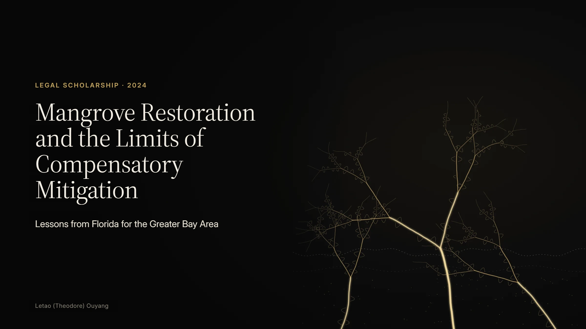
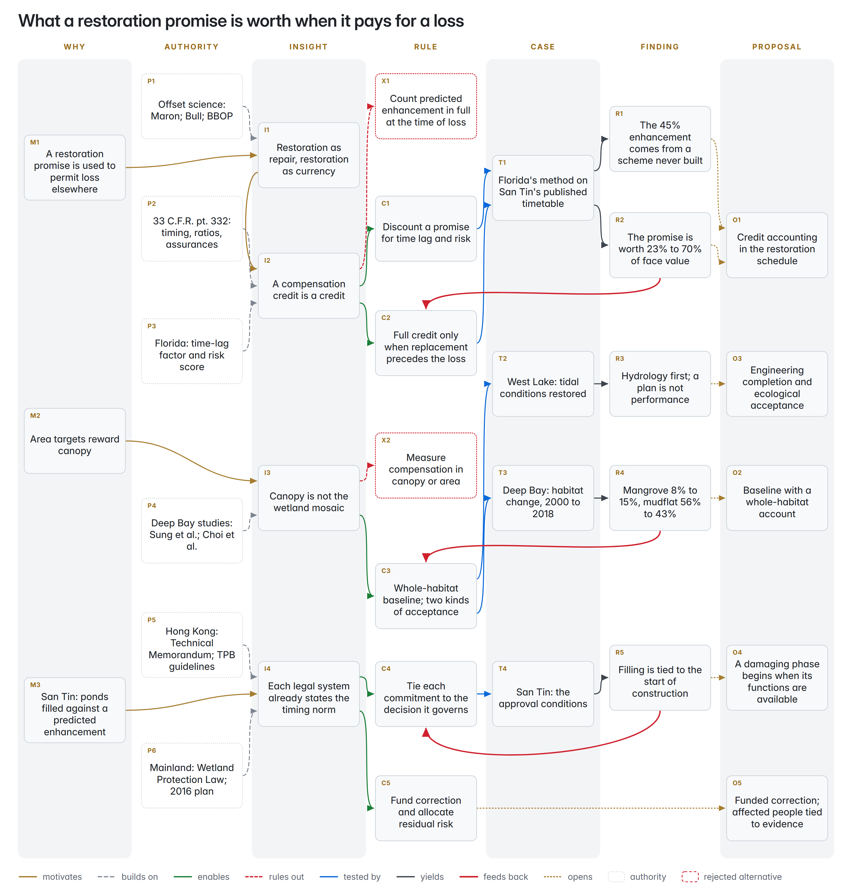

# Mangrove Restoration and the Limits of Compensatory Mitigation: Lessons from Florida for the Greater Bay Area

**Letao (Theodore) Ouyang** · Duke Law School · December 2024; revised November 2026

[Article](manuscript/mangrove-restoration-and-the-limits-of-compensatory-mitigation.md) · [PDF](paper/paper.pdf) · [Argument map](docs/argument-map.md) · [Proposal](docs/proposal.md) · [Research route](docs/research-route.md) · [Literature](docs/literature.md)

**What is a promise of future wetland function worth when it is used to permit a loss today?**

An authority may approve a mangrove restoration project because it offers a reasonable prospect of repairing
degraded habitat. Relying on the same project to authorize destruction elsewhere requires a further judgment about
replacement functions, delay and failure. This Article develops that distinction through a comparison of Florida
and the Guangdong-Hong Kong-Macao Greater Bay Area. It treats a compensation credit as what the word says: a
credit, to be discounted for delay and default, secured, and released against performance. Florida's uniform
mitigation assessment method does exactly that, and credits a promised gain in full only when the replacement
precedes the loss. Applied to the published timetable of the San Tin development in Hong Kong, the Florida method
would credit between roughly a quarter and seven tenths of the enhancement that the environmental assessment
counted in full.

## Three claims to start with

| Claim | Why it matters | Where |
| --- | --- | --- |
| **Restoration enters law as repair and as currency, and a compensation credit is a credit.** Its value depends on when it will be redeemed, on the chance that it will not be, on the security behind it and on the schedule of draws | Repair can be tried on modest evidence, because nothing has been borrowed against it. Compensation is discounted, secured and released in stages, because something has | [Part II.C](manuscript/mangrove-restoration-and-the-limits-of-compensatory-mitigation.md) · [Proposal](docs/proposal.md#c-credit-accounting-when-restoration-is-used-as-currency) |
| **Under Florida's rule, San Tin's promised enhancement is worth 23% to 70% of its face value.** The share credited is the reciprocal of the product of a time-lag factor and a risk score, and no row of the table credits the promise in full | The calculation measures the judgment the approval leaves unexamined: whether the start of construction can stand in for function at a discount of zero | [Part V](manuscript/mangrove-restoration-and-the-limits-of-compensatory-mitigation.md) · [Argument map](docs/argument-map.md#part-v-san-tin-and-reliance-on-future-wetland-function) |
| **The timing norm is already written in each legal system compared.** Federal rules, Florida's method, Hong Kong's Technical Memorandum and planning guidelines, and mainland policy each put replacement before or with the loss | The reform needs no new principle. It gives the existing ones a decision to govern: the point at which a damaging phase may begin | [Part VI.C](manuscript/mangrove-restoration-and-the-limits-of-compensatory-mitigation.md) · [Proposal](docs/proposal.md#the-timing-norm-in-each-jurisdiction) |

## The problem

Mangrove restoration is promoted across the Greater Bay Area by national targets, provincial incentives and local
regulations, and it is also offered as compensation for wetland that development will destroy. The two uses call
for different scrutiny. In Deep Bay between 2000 and 2018, mapped mangrove cover rose from 8 to 15 percent and other
vegetation from 3 to 14 percent while mudflat fell from 56 to 43 percent: a scheme that measured compensation in
canopy would have recorded the first of those changes as a gain. At San Tin, an environmental assessment counted a
predicted 45 percent enhancement of retained fishponds against the loss of others. The figure was taken from an
earlier assessment whose compensation measures were never implemented, and the conservation park that is to
deliver the enhancement is scheduled for completion by 2039, while pond filling may begin in 2026/27.

## The argument in brief

1. **Comparing legal decisions and ecological outcomes** (Part II). Functions are compared, and not counts of
   statutes. Attribution needs an explicit chain from duty to decision to conduct to function. Restoration as
   repair and restoration as currency warrant different scrutiny.
2. **The governing legal frameworks** (Part III). China's Wetland Protection Law addresses mangroves and
   hydrological disruption; Shenzhen connects ecological assessment to project acceptance; Hong Kong's planning
   guidelines for Deep Bay measure loss in area and in function. Federal rules call for advance or concurrent
   compensation, and Florida prices delay and failure.
3. **Restoration evidence and its limits** (Part IV). West Lake shows the value of restoring tidal conditions.
   Research in Deep Bay shows why canopy cannot stand in for the wetland mosaic.
4. **San Tin and reliance on future wetland function** (Part V). The particulars of the predicted enhancement, and
   what the timetable is worth under Florida's method.
5. **Conditions for accountable restoration** (Part VI). Existing instruments tied to specified decisions, a
   defensible baseline, engineering completion separated from ecological acceptance, funded correction, and a role
   for affected people.
6. **Costs, measurement and enforcement** (Part VII).

## Florida's arithmetic on San Tin's timetable

A function lost when filling begins and replaced when the park is complete would carry a time lag of about twelve
years, and a shorter lag for ponds filled later or enhancement delivered earlier. The share of a promised gain
that Florida's rule credits:

| Time lag | Time-lag factor | Share credited at risk score 1.25 | At risk score 2.0 | At risk score 3.0 (high risk) |
| --- | --- | --- | --- | --- |
| 5 years | 1.14 | 70% | 44% | 29% |
| 6 to 10 years | 1.25 | 64% | 40% | 27% |
| 11 to 15 years | 1.46 | 55% | 34% | 23% |

Full credit under the rule requires replacement that offsets the impact at or before the time of loss, with a
record of success. Florida's rule has no force in Hong Kong. The table shows the size of the question.

## What the Article contributes

1. **Repair and currency.** The distinction between restoration as an end in itself and restoration that pays for
   a loss, with the four properties of a credit matched to their regulatory counterparts: discounts for delay,
   ratios for the likelihood of success, financial assurances, and release against performance.
2. **A statutory discount applied across legal systems.** Florida's time-lag and risk factors applied to a
   published timetable in Hong Kong, as a measure of what a predicted enhancement is worth.
3. **The whole-habitat account.** Evidence from Deep Bay read as a condition of crediting: every habitat is on the
   ledger, so a gain in canopy cannot be booked while mudflat is lost.
4. **A timing norm found in each jurisdiction.** Federal regulation, Florida's method, Hong Kong's memorandum and
   guidelines, and mainland law and policy, so that the reform gives existing principles a decision to govern.
5. **A restoration schedule.** Conditions that connect a defensible baseline and locally justified objectives to
   staged authorization, funded correction and continuing responsibility.

[Where this Article sits](docs/literature.md) sets these against the science of offsets, United States mitigation
law and the studies of Deep Bay, and the [bibliography](docs/bibliography.md) lists all 163 authorities and
sources.

## The proposal

A restoration schedule attached to the approval, plan or funding agreement. It names the decisions each commitment
governs, records a baseline that covers the whole habitat mosaic, states for each damaging phase the lag, the risk
and the credit that results, separates engineering completion from ecological acceptance, funds correction in
advance, and gives affected people a role tied to evidence. The [proposal](docs/proposal.md) sets it out section
by section.

## How the argument was built

<picture>
  <source media="(prefers-color-scheme: dark)" srcset="assets/route-dark.png">
  
</picture>

The route is a network. The account of credit, the cases and the schedule were worked out against each other, and
three findings went back and changed a rule.

- **What a promise is worth.** No row of Florida's table credits San Tin's promise in full, which fixed the rule
  that full credit is reserved for replacement that precedes the loss.
- **What is being replaced.** Deep Bay gained mangrove and lost mudflat, so the baseline became the whole mosaic.
- **Which decision the promise governs.** The approval ties pond filling to the start of construction, so the
  governed decision was defined as the start of each damaging phase.

The [research route](docs/research-route.md) explains all 34 steps and all 36 links.

## Repository

| Path | Contents |
| --- | --- |
| [`manuscript/`](manuscript/mangrove-restoration-and-the-limits-of-compensatory-mitigation.md) | The Article, with its notes |
| [`paper/paper.pdf`](paper/paper.pdf) | The Article as a PDF |
| [`docs/argument-map.md`](docs/argument-map.md) | Each claim, the authority or evidence it rests on, the strongest objection and the response |
| [`docs/proposal.md`](docs/proposal.md) | The restoration schedule, with credit accounting and the timing norm in each jurisdiction |
| [`docs/research-route.md`](docs/research-route.md) | The logic of the Article as a network, node by node |
| [`docs/literature.md`](docs/literature.md) · [`docs/bibliography.md`](docs/bibliography.md) | Where the Article sits, and the 163 authorities and sources |

## Citation

Letao (Theodore) Ouyang, *Mangrove Restoration and the Limits of Compensatory Mitigation: Lessons from Florida for the
Greater Bay Area* (Duke Law School, 2024),
<https://www.theodoreoy.com/experience/mangrove-restoration-and-the-limits-of-compensatory-mitigation/>. See
[CITATION.cff](CITATION.cff).

[theodore.oy2025@gmail.com](mailto:theodore.oy2025@gmail.com) · [10@alumni.duke.edu](mailto:10@alumni.duke.edu)

© Letao (Theodore) Ouyang. All rights reserved.
