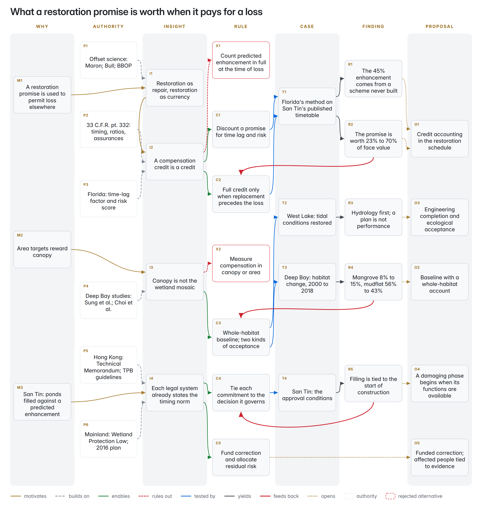

# Research route

How the argument was built: which body of authority supports which step, where a finding went back and changed a
rule, and what the rules become as instruments. The Article does not run from problem to solution in one line. The
account of credit, the cases and the schedule were worked out against each other, because a rule about crediting a
promise is only as good as the promises it is tested on.

<picture>
  <source media="(prefers-color-scheme: dark)" srcset="../assets/route-dark.png">
  
</picture>

## Reading the figure

Columns are kinds of step, not stages in time. A link can run between any two columns, and three run backwards,
from a finding to a rule.

| Link | Meaning |
| --- | --- |
| motivates | A problem or an insight that made the next step necessary |
| builds on | An authority the step rests on |
| enables | A step that makes another one possible |
| tested by / yields | A rule and the case that tests it; a case and what it shows |
| feeds back | A finding that changed a rule |
| rules out | A step that excludes an alternative |
| opens | A rule or finding that becomes an instrument |

Solid boxes are the Article's own steps. Dotted boxes are authority, and red dashed boxes are positions the Article
rejects.

## The three threads

### 1. What a promise is worth

M1 → I1 → I2 → C1, C2 → T1 → R1, R2, with I2 ruling out X1 and R2 feeding back into C2.

A restoration project can be approved because it offers a reasonable prospect of repairing degraded habitat. Using
the same project to authorize destruction elsewhere is a different legal job (M1). Restoration enters law in two
roles (I1): as repair, an end in itself, and as currency, which pays for permission to destroy present function.
Spent as currency, its unit is a credit (I2), and a credit has four properties: when it will be redeemed, the
chance that it will not be, the security behind it, and the schedule of draws. Each has a counterpart in the
federal mitigation rule (P2), and Florida prices the first two in numbers (P3). Counting a predicted enhancement
in full at the moment of loss is taking an unsecured note at face value (X1).

Two rules follow: a promise is discounted for time lag and risk (C1), and it is credited in full only when the
replacement precedes the loss (C2). The test is Florida's method applied to San Tin's published timetable (T1).
The predicted 45 percent enhancement was taken from an assessment whose compensation measures were never
implemented (R1), and at lags of five to about twelve years the promise is worth between 23 and 70 percent of its
face value (R2). No row of the table credits it in full, and that finding fixed the second rule (R2 → C2).

### 2. What is being replaced

M2 → I3 → C3 → T2, T3 → R3, R4, with I3 ruling out X2 and R4 feeding back into C3.

Targets stated in area reward canopy (M2). In Deep Bay between 2000 and 2018 mangrove cover rose from 8 to 15 percent
while mudflat fell from 56 to 43 percent (P4, T3, R4). Canopy is not the wetland mosaic (I3), and a scheme that
measured compensation in canopy would have booked that change as a gain, which rules out canopy or area as the
measure (X2). The rule is a baseline that records every habitat, and ecological acceptance kept separate from
engineering completion (C3). The finding from Deep Bay went back into it (R4 → C3): the baseline has to be the
whole mosaic. West Lake shows the other half (T2, R3): restoring tidal conditions is the credible intervention
where tidal restriction limits recovery, and a mitigation plan is not proof that functions were replaced.

### 3. Which decision the promise governs

M3 → I4 → C4, C5 → T4 → R5, with R5 feeding back into C4.

At San Tin, ponds are to be filled against a predicted enhancement of other ponds (M3), and the dispute is about
when the loss may begin. Each legal system compared already states a timing norm (I4): Hong Kong's Technical
Memorandum prefers mitigation before the works and its planning guidelines measure loss in function (P5), and
mainland policy stated the principle of compensating first and occupying later (P6). The principles need a
decision to govern (C4) and a consequence when a milestone fails (C5). The approval conditions (T4) tie pond
filling to the start of construction (R5). Commencement shows that work began, and not that functions operate, so
the governed decision is defined as the start of each damaging phase (R5 → C4).

## From findings to instruments

| Instrument | Comes from | What it does |
| --- | --- | --- |
| O1 Credit accounting | R1, R2 | For each damaging phase the schedule states the lag, the risk score and the credit that results ([schedule](proposal.md)) |
| O2 Baseline with a whole-habitat account | R4 | Mangrove, mudflat, pond and other vegetation are recorded together |
| O3 Two kinds of acceptance | R3 | Completion of works and recovery of function are accepted separately |
| O4 Phased authorization | R5 | A damaging phase begins when the functions it destroys are available |
| O5 Funded correction and participation | C5 | A funded obligation to monitor and correct, and a role for affected people tied to evidence and decisions |

## Every node

| Node | Column | What it is |
| --- | --- | --- |
| **M1** A restoration promise is used to permit loss elsewhere | Why | Relying on a restoration project to authorize destruction requires a judgment about replacement, delay and failure. |
| **M2** Area targets reward canopy | Why | Targets and standards stated in hectares or canopy can attract more attention than function. |
| **M3** San Tin: ponds filled against a predicted enhancement | Why | The environmental assessment counted a predicted enhancement of retained ponds against the loss of others. |
| **P1** Offset science: Maron; Bull; BBOP | Authority | The conditions under which restoration can offset a loss: measurability, evidence of restorability, time lags and uncertainty. |
| **P2** 33 C.F.R. pt. 332: timing, ratios, assurances | Authority | Advance or concurrent compensation, ratios for temporal loss and risk, financial assurances and release of credits against performance. |
| **P3** Florida: time-lag factor and risk score | Authority | Fla. Stat. § 373.414(18) and Fla. Admin. Code r. 62-345.600. |
| **P4** Deep Bay studies: Sung et al.; Choi et al. | Authority | Habitat change from 2000 to 2018 and twenty years of waterbird trends, and the conflict between mangrove expansion and shorebird habitat. |
| **P5** Hong Kong: Technical Memorandum; TPB guidelines | Authority | A preference for mitigation before the works, and no net loss of wetland in area and in function. |
| **P6** Mainland: Wetland Protection Law; 2016 plan | Authority | Replacement of equivalent area and quality, and the principle of compensating first and occupying later. |
| **I1** Restoration as repair, restoration as currency | Insight | As repair, restoration is an end in itself. As currency, it pays for permission to destroy present function. |
| **I2** A compensation credit is a credit | Insight | Its value depends on when it is redeemed, on the chance of default, on the security behind it and on the schedule of draws. |
| **I3** Canopy is not the wetland mosaic | Insight | More mangrove can mean less mudflat, so a gain in canopy is not a gain in the functions of the whole wetland. |
| **I4** Each legal system already states the timing norm | Insight | Federal rules, Florida's method, Hong Kong's memorandum and guidelines, and mainland policy each put replacement before or with the loss. |
| **X1** Count predicted enhancement in full at the time of loss | Rule | Rejected: no lender takes at face value an unsecured note payable in a decade. |
| **C1** Discount a promise for time lag and risk | Rule | The expected gain is divided by a time-lag factor and a risk score. |
| **C2** Full credit only when replacement precedes the loss | Rule | A promise is credited at face value when the replacement is in place, and working, before the loss. |
| **X2** Measure compensation in canopy or area | Rule | Rejected: a scheme that measured compensation in canopy would record the loss of mudflat as a gain. |
| **C3** Whole-habitat baseline; two kinds of acceptance | Rule | A baseline that states what is degraded and for whom, and ecological acceptance kept separate from engineering completion. |
| **C4** Tie each commitment to the decision it governs | Rule | Permission to alter the site, release of funds, acceptance, the start of each damaging phase and discharge of responsibility. |
| **C5** Fund correction and allocate residual risk | Rule | Who reviews a failed milestone, how fast, with which options and what funding. |
| **T1** Florida's method on San Tin's published timetable | Case | A function lost when pond filling begins and replaced when the conservation park is complete, a lag of about twelve years. |
| **T2** West Lake: tidal conditions restored | Case | Grades matched to a reference forest, tidal creeks added, natural recruitment of mangroves. |
| **T3** Deep Bay: habitat change, 2000 to 2018 | Case | Mapped cover of mangrove, other vegetation and mudflat, with waterbird trends. |
| **T4** San Tin: the approval conditions | Case | The conditions attached to the approval of the environmental assessment, including condition 9. |
| **R1** The 45% enhancement comes from a scheme never built | Finding | The figure was taken from the approved 2008 assessment for Fung Lok Wai, whose compensation measures were not implemented. |
| **R2** The promise is worth 23% to 70% of face value | Finding | Under Florida's rule no row of the table credits the promise in full: 70%, 44% and 29% at five years, down to 55%, 34% and 23% at eleven to fifteen. |
| **R3** Hydrology first; a plan is not performance | Finding | Restoring tidal conditions is credible where tidal restriction limits recovery, and a mitigation plan does not show that functions were replaced. |
| **R4** Mangrove 8% to 15%, mudflat 56% to 43% | Finding | Other vegetation rose from 3% to 14%. Canopy alone would have booked the change as a gain. |
| **R5** Filling is tied to the start of construction | Finding | Commencement shows that work began, and not that functions operate. |
| **O1** Credit accounting in the restoration schedule | Proposal | For each damaging phase: the lag, the risk score and the credit that results. |
| **O3** Engineering completion and ecological acceptance | Proposal | Different milestones, with justified ranges, seasonal coverage and a named authority for changes. |
| **O2** Baseline with a whole-habitat account | Proposal | Mangrove, mudflat, pond and other vegetation recorded together. |
| **O4** A damaging phase begins when its functions are available | Proposal | The schedule names the functions that must exist before each phase of loss. |
| **O5** Funded correction; affected people tied to evidence | Proposal | A funded obligation to monitor and correct, and a role for pond operators, tenants and residents in checking the baseline and the milestones. |

## Every link

| # | From | To | Link | Why |
| ---: | --- | --- | --- | --- |
| 1 | M1 | I1 | motivates | The same project is asked to do two different legal jobs |
| 2 | P1 | I1 | builds on | The conditions under which an offset is credible |
| 3 | I1 | I2 | motivates | If restoration is spent as currency, its unit is a credit |
| 4 | P2 | I2 | builds on | Each property of a credit has a counterpart in the federal rule |
| 5 | P3 | I2 | builds on | Florida prices delay and failure in numbers |
| 6 | I2 | X1 | rules out | A promise taken at face value is an unsecured note |
| 7 | I2 | C1 | enables | Delay and default are discounted |
| 8 | I2 | C2 | enables | Face value is earned by performance before the loss |
| 9 | M2 | I3 | motivates | What is easy to count is not what the birds use |
| 10 | P4 | I3 | builds on | Measured habitat change in the receiving ecosystem |
| 11 | I3 | X2 | rules out | Canopy cannot stand in for the mosaic |
| 12 | I3 | C3 | enables | The baseline records every habitat, and acceptance follows function |
| 13 | M3 | I4 | motivates | The dispute is about when the loss may begin |
| 14 | P5 | I4 | builds on | Hong Kong's stated preference and its functional standard |
| 15 | P6 | I4 | builds on | Equivalence and sequence in mainland law and policy |
| 16 | I4 | C4 | enables | The principles need a decision to govern |
| 17 | I4 | C5 | enables | A decision point needs a consequence when a milestone fails |
| 18 | C1 | T1 | tested by | What the discount yields on a real timetable |
| 19 | C2 | T1 | tested by | Whether any plausible case earns full credit |
| 20 | C3 | T2 | tested by | A restoration judged by tidal function |
| 21 | C3 | T3 | tested by | A wetland where one habitat grew at the expense of another |
| 22 | C4 | T4 | tested by | Which decision the conditions actually govern |
| 23 | T1 | R1 | yields | The source of the predicted enhancement |
| 24 | T1 | R2 | yields | The credited share, by lag and risk |
| 25 | T2 | R3 | yields | What the Florida site does and does not show |
| 26 | T3 | R4 | yields | The whole habitat account |
| 27 | T4 | R5 | yields | The point of reliance in the conditions |
| 28 | R2 | C2 | feeds back | No row credits the promise in full, so full credit is reserved for replacement that precedes the loss |
| 29 | R4 | C3 | feeds back | The baseline has to be the whole mosaic, because canopy would have recorded a gain |
| 30 | R5 | C4 | feeds back | The governed decision is the start of a damaging phase, and commencement of works is not that |
| 31 | R1 | O1 | opens | The risk score reflects whether success has been observed |
| 32 | R2 | O1 | opens | The schedule states the lag, the risk and the credit |
| 33 | R3 | O3 | opens | Completion of works and recovery of function are accepted separately |
| 34 | R4 | O2 | opens | Every habitat is on the ledger |
| 35 | R5 | O4 | opens | Each phase waits for the functions it destroys |
| 36 | C5 | O5 | opens | Correction is funded before it is needed |
